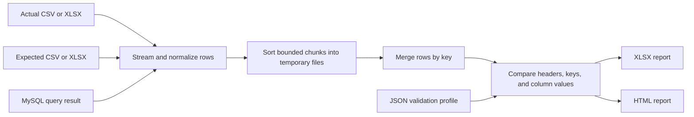

# Bulk File Validator

Bulk File Validator checks whether an actual data set matches an expected data set. It can compare CSV/XLSX files with each other, or compare a CSV/XLSX file with rows returned by a MySQL query. Rows are paired by a key column, and the report explains missing records, extra records, schema differences, duplicate keys, and unequal values.

## At a glance



## How a comparison works

1. The validator reads the headers from both sources and matches columns by name. Header case and surrounding whitespace are ignored by default; column order can differ.
2. Each source is read a row at a time. CSV rows, the first worksheet in an XLSX file, or rows from a forward-only MySQL result set are supported.
3. Rows are sorted in bounded-size chunks using the configured key. Sorted chunks are written to temporary files, so the full data set does not need to fit in memory.
4. The sorted sources are merged and compared by key. A JSON profile can set different comparison rules for each column.
5. The validator writes an Excel workbook and a matching standalone HTML report. Temporary sort files are removed when the comparison finishes.

The report passes only if there are no header or value mismatches, missing or extra rows, duplicate keys, or malformed rows. Duplicate-key groups are reported as ambiguous rather than paired arbitrarily. Rows with blank keys or the wrong number of fields are reported and skipped.

## Data sources

| Actual source | Expected source | Supported formats |
| --- | --- | --- |
| CSV or XLSX | CSV or XLSX | CSV uses the first row as headers. XLSX uses the first worksheet. |
| CSV or XLSX | MySQL query | The SQL result is treated as the expected data set. |

Database mode currently supports MySQL. The query result must include the key column and the expected data columns. Use SQL aliases to make result labels match the actual file's headers. The validator compares the columns returned by the query; a column added to a database table is not included unless the SQL selects it. For example:

```sql
SELECT
    payment_auth_id AS `Payment / Auth ID`,
    status2 AS `status2`
FROM bulk_validator.transactions;
```

If `status2` is not present in the actual file, the report identifies it as a header mismatch.

## Architecture

The source code is organized around a small set of responsibilities:

| Component | Responsibility |
| --- | --- |
| `BulkFileComparator` | Coordinates source reading, header validation, external sorting, key-based merge comparison, cleanup, and report output. Its public `compare` methods accept file sources or a MySQL source. |
| `JdbcQueryConfig` | Holds MySQL connection settings, SQL text, fetch size, and optional query timeout. |
| `ColumnRule` | Describes how to compare one column, including string/decimal type, whitespace, case, nulls, and numeric tolerance. |
| `ValidationProfile` | Groups a key column and named `ColumnRule` settings into a reusable profile. |
| `RuleConfigLoader` | Loads a JSON profile and validates required settings. |
| `RuleBasedValueComparator` | Applies a column's normalization policy and determines whether two values match. |
| `ReportWriter` (inside `BulkFileComparator`) | Writes summary and mismatch data to XLSX and HTML. Sensitive values are redacted in mismatch output. |

The file and database entry points are small runnable Java classes under `src/test/java/execution`. They are ordinary `main` programs, not JUnit tests.

## Requirements and build

- Java 17 or later
- Maven 3.8 or later
- MySQL and network access to it when using database mode

Build the project from its root directory:

```bash
mvn clean package
mvn dependency:copy-dependencies
```

Apache Commons CSV reads CSV input, Apache POI streams XLSX input and writes Excel reports, Jackson reads JSON profiles, and MySQL Connector/J provides database connectivity.

## Run file-to-file validation

The `execution.Test` entry point compares the sample files using `config/transaction-reconciliation-profile.json`:

```text
Actual:   input/actual.csv
Expected: input/expected.csv
Reports:  output/comparison-report.xlsx
          output/comparison-report.html
```

Run `execution.Test` as a Java application in your IDE, with the project root as its working directory.

For custom paths or profiles, use `ProfileBasedTest`:

```text
ProfileBasedTest <actual.csv|actual.xlsx> <expected.csv|expected.xlsx> <report.xlsx> [profile.json]
```

Example command for Windows PowerShell:

```powershell
java -cp "target/classes;target/dependency/*" `
  com.test.qa.utils.excel.comparision.ProfileBasedTest `
  input/actual.csv input/expected.csv output/comparison-report.xlsx `
  config/transaction-reconciliation-profile.json
```

On Linux or macOS, use `:` between classpath entries instead of `;`.

## Run database-to-file validation

`execution.DatabaseTest` uses these defaults:

- Actual file: `input/actual.csv`
- SQL query: `config/expected-transactions.sql`
- Profile: `config/transaction-reconciliation-profile.json`
- Reports: `output/database-comparison-report.xlsx` and `output/database-comparison-report.html`

Create `.env` in the project root from `.env.example`, then set your database password:

```dotenv
BULK_VALIDATOR_DB_URL=jdbc:mysql://192.168.1.108:3306/bulk_validator
BULK_VALIDATOR_DB_USER=bulkvalidator
BULK_VALIDATOR_DB_PASSWORD=your_database_password
```

The `.env` file is ignored by Git. Process environment variables with these names override values in `.env`. Keep the database user limited to the required `SELECT` privileges, and allow connections from the machine running the validator.

Run `execution.DatabaseTest` as a Java application with the project root as its working directory. Optional arguments override the defaults, in this order:

```text
DatabaseTest [actual.csv|actual.xlsx] [query.sql] [report.xlsx] [profile.json]
```

The command-line entry point `ProfileBasedTest` also supports database mode. It reads connection settings from process environment variables (it does not load `.env`):

```text
ProfileBasedTest --db <actual.csv|xlsx> <report.xlsx> <query.sql> [profile.json]
```

In database mode the HTML report displays the SQL query under **Expected source**. The query section can be expanded and copied. The Excel summary and console show `MySQL query result`; reports do not include the JDBC URL, username, or password.

## Validation profiles

A profile is JSON with a `profileName`, a `keyColumn`, and a `columns` object. Column names in the profile are matched without regard to case. Columns without an explicit rule use default string comparison.

Important column settings:

| Setting | Behavior |
| --- | --- |
| `type` | `STRING` or `DECIMAL`. |
| `trimWhitespace` | Trims values before comparison. Defaults to `true`. |
| `caseSensitive` | Controls letter-case comparison for strings. Defaults to `true`. |
| `nullEqualsBlank` | Allows explicit null and blank values to match. Defaults to `false`. |
| `whitespaceOnlyIsBlank` | Treats whitespace-only text as blank. Defaults to `true`. |
| `ignoreExpectedBlank` | Skips the cell comparison when the expected value is blank, SQL `NULL`, or a configured null token. Defaults to `false`. |
| `nullTokens` | Text such as `NULL` or `N/A` to interpret as explicit nulls. |
| `scale` and `roundingMode` | Validate whether a decimal can be represented at the specified scale. |
| `tolerance` | Maximum allowed absolute difference between decimal values. Defaults to `0`. |

Example rule:

```json
{
  "profileName": "transaction-reconciliation",
  "keyColumn": "Payment / Auth ID",
  "columns": {
    "Channel": {
      "type": "STRING",
      "caseSensitive": false,
      "ignoreExpectedBlank": true,
      "nullTokens": ["NULL", "N/A"]
    },
    "Gross Amount": {
      "type": "DECIMAL",
      "scale": 2,
      "roundingMode": "HALF_UP",
      "tolerance": "0.01"
    }
  }
}
```

`ignoreExpectedBlank` is useful for optional expected-side fields. It does not skip a comparison when the actual value is blank and the expected value is populated. Decimal tolerance is applied to the exact source values; rounding cannot by itself hide a difference.

The supplied profiles are `config/sample-validation-profile.json` and `config/transaction-reconciliation-profile.json`.

## Reports

For an XLSX path such as `output/comparison-report.xlsx`, the matching HTML file is created beside it as `output/comparison-report.html`.

- **Summary** shows source details, row counts, mismatch totals, execution status, and PASS/FAIL.
- **Mismatches** lists schema, key, row, value, and processing errors with useful details.
- The HTML report is self-contained and can be opened in a browser without network access. Database reports include a collapsible, copyable SQL view.
- Sensitive column values and PAN-like digit sequences are redacted in mismatch details.

## Memory and data handling

- Rows are sorted in chunks controlled by `Config.chunkSize` (default: 50,000) and merged from temporary files.
- Lower chunk sizes use less memory but produce more temporary runs.
- CSV uses comma delimiters by default. XLSX input is read from the first worksheet.
- Database rows are fetched through a forward-only cursor. The default fetch size is 1,000 rows; `JdbcQueryConfig` can change the fetch size or set a query timeout.
- Temporary sort files are removed after the comparison, including when processing fails.
- SQL values are read as text for comparison. Use SQL formatting functions such as `DATE_FORMAT` when a database value must match a text-formatted file value.
